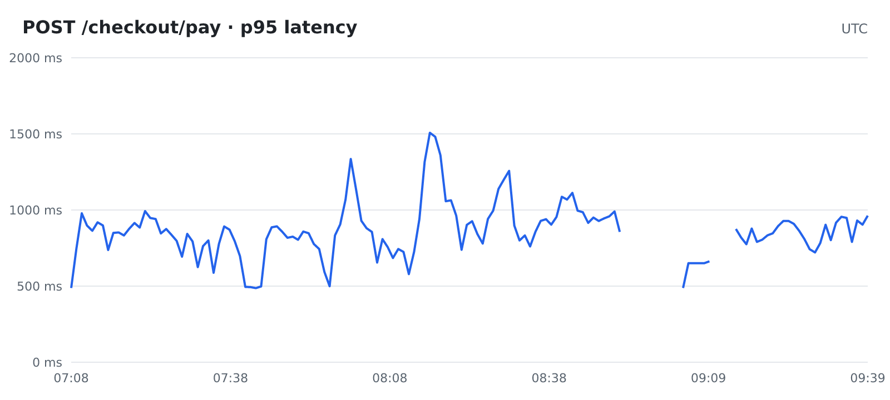
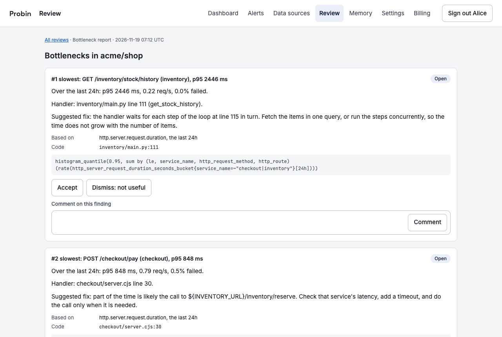

# Probin

A hosted product for small teams whose software is written with Claude Code: ask for a
chart, an alert or a data source in plain language, and review code with production
metrics in view.

The full plan is in [docs/build-plan.md](docs/build-plan.md). **All six phases are built.** Watch
answers chart, alert and data-source requests in Slack and the web tool; Review reads code and live
metrics to find bottlenecks, comment on pull requests, follow up after deploys and review the
architecture. Slack, GitHub, Stripe and the model are replaced by local fakes until real credentials
are set (see the runbooks).

## What it looks like

These were taken from the local stack (`make dev`), with the fake Slack, the stand-in model and the
two demo services.

**1. Ask in Slack.** Mention the bot with a plain request. It asks at most two short questions
(here: which endpoint, and whether to count failures), then posts a chart with a one-line reading,
its assumptions and the query it ran:

```text
alice  @bot p95 latency of checkout service in last 3 hr
bot    Which endpoint?                    → POST /checkout/pay · alice
bot    Count failed requests too?         → Yes, all requests
bot    P95 latency was 963 ms most recently, between 487 ms and 1507 ms over the last 3 hours.
       [chart below]
       Assumed: p95 · all requests including failures · all regions combined
       [Save to dashboard] [Alert me on this] [Open in web] [Skip questions next time]
```



**2. The dashboard.** Saved charts live in the web tool (<http://localhost:8094>). Each panel shows
its query and assumptions and can be changed by typing what you want ("split by endpoint, last 24
hours"). Dashboards can be shared, or exported to Grafana.


**3. Alerts.** "Alert me if …" creates a rule that does nothing until someone approves it. New
services also get suggested rules, shown here waiting for approval.


**4. Review.** Review reads the code alongside live metrics. The bottleneck report ranks the slowest
endpoints, points at the handler line and suggests a fix. It also comments on pull requests.



## Run it

You need Node 22.12 or newer, pnpm, Docker with Compose, and Make.

```sh
make dev      # start everything: stores, our services, demo services, fake Slack, Stripe and GitHub
make verify   # every phase's acceptance check, the integration tests and the query test set
make check    # lint, type-check and unit tests (no containers needed)
```

Then ask for a chart:

```sh
pnpm ask "latency graph of checkout service in last 5 hr"
```

With no model key set, a built-in stand-in answers plain requests, so everything runs
without spending anything. To use real models, set `OPENROUTER_API_KEY` in `.env` and
follow [evals/README.md](evals/README.md).

Open <http://localhost:8094> and sign in with the fake Slack. `make help` lists every command.
The runbooks cover each phase, connecting real services, and what to do when something fails:
[0](docs/runbooks/phase-0.md), [1](docs/runbooks/phase-1.md), [2](docs/runbooks/phase-2.md),
[3](docs/runbooks/phase-3.md), [4](docs/runbooks/phase-4.md), [5](docs/runbooks/phase-5.md).

## Layout

```text
apps/
  ingest/      ingestion endpoint: keys, OTLP in, manifest registration, catalog sync
  query-api/   the only service that talks to the metrics store: limits, isolation, cache
  agent/       the one agent: tools, the "get a metric" loop, prompts
  slack/       the Slack app (and a fake Slack for development)
  web/         the web tool, billing, the read-only API (and a fake Stripe)
  alerts/      the alert engine
  review/      Review: GitHub app, code index, analyses (and a fake GitHub)
  connector/   the connector for Claude Code (MCP)
packages/
  config/      the product name constant; environment and plans loading
  specs/       types and validators for panel, dashboard, alert, collector, manifest
  db/          schema, migrations, spec store
  promql/      reads a query's names; scopes a query to a workspace
  catalog/     name mapping, registration, search, sync, the convention checks
  router/      model routing through OpenRouter: tiers, budget, escalation, call log
  memory/      per-workspace memory
  charts/      chart rendering (SVG, PNG) and the one-line reading
skill/         the skill for Claude Code (source; `pnpm skill:build` fills in the name)
evals/         the query test set and the review test set
infra/         compose file, collector config, demo services and their baselines
config/        example plans and models files
docs/          the build plan, decisions, runbooks
scripts/       acceptance checks and repository checks
```

## Rules for contributors

- Build one phase at a time. A phase is done when its acceptance tests pass.
- The product name lives in one constant, `PRODUCT_NAME` in `packages/config`. Do not
  write it anywhere else in code, configuration, package names or URLs.
  `pnpm check:product-name` enforces this.
- No secrets in the repository. Keys come from the environment.
- Tests ship with the code. Choices the plan leaves open are recorded in
  [docs/decisions.md](docs/decisions.md).
