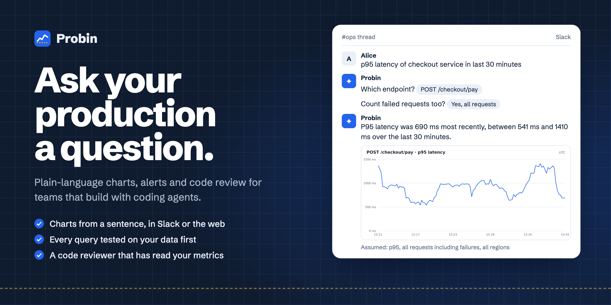
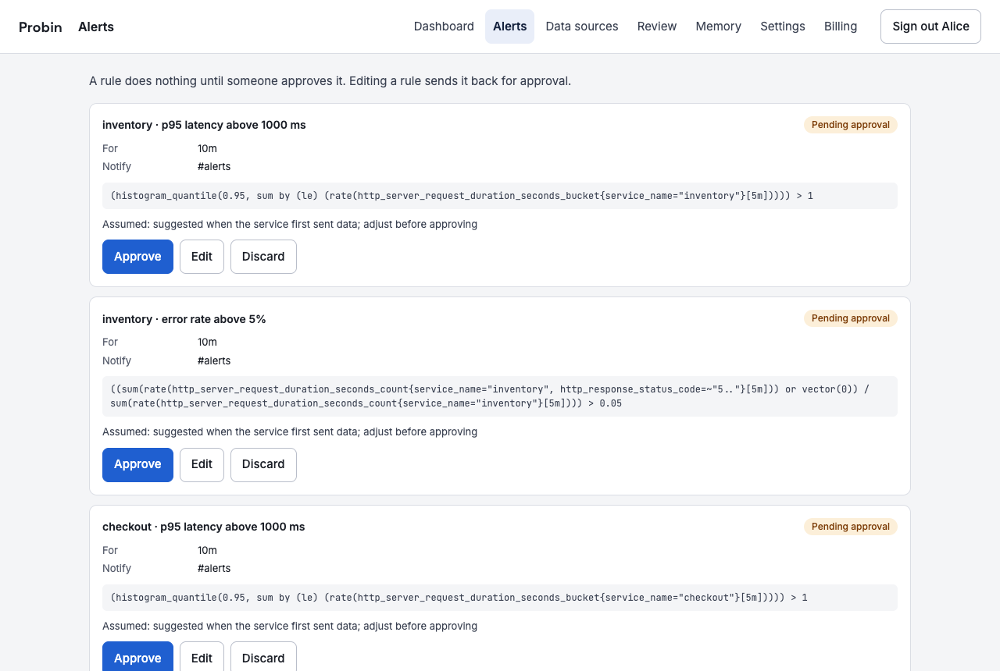
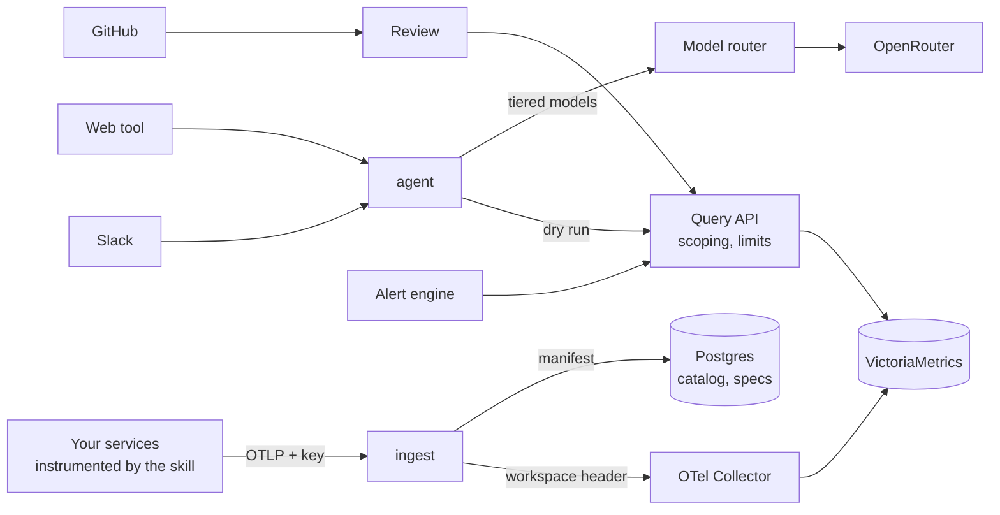

<div align="center">

# Probin

### Ask your production a question.

Type what you want to see, in Slack or the web. Probin finds the metric, writes the query, tests it,
and hands back a chart that shows its working. Then it reviews your code with those metrics in view.

**Built for teams whose software is written by coding agents like Claude Code.**

[](https://vercel.com/new/clone?repository-url=https%3A%2F%2Fgithub.com%2Fshubh-tiwari%2Fprobin)


[Quick start](#quick-start) · [How it works](#how-it-works) · [Features](#features) ·
[Architecture](#architecture) · [Deploy](#deploy)

<br />



</div>

---

## Why

Dashboards are slow to build, and asking a model for a query gives you something that _looks_ right:
a metric name it guessed, a label that doesn't exist, a chart of nothing. Probin closes that gap.

```text
alice  @bot p95 latency of checkout service in last 30 minutes
bot    Which endpoint?                    → POST /checkout/pay
bot    Count failed requests too?         → Yes, all requests
bot    P95 latency was 690 ms most recently, between 541 ms and 1410 ms over the last 30 minutes.
       [chart]
       Assumed: p95 · all requests including failures · all regions combined
       [Save to dashboard] [Alert me on this] [Open in web] [Skip questions next time]
```

At most two questions. Every other choice is stated as an assumption you can change. The query is
shown, and it has already been run against your data.

## How it works

1. **Instrument with Claude Code.** A skill adds OpenTelemetry metrics that follow one convention,
   and writes a manifest of every endpoint and metric.
2. **Ask in plain language.** In Slack or the web tool. The agent searches your catalog, asks what
   it can't infer, writes the query and runs it before you see it.
3. **Keep it, watch it.** Save it to a dashboard, or turn it into an alert that waits for a person
   to approve it.

## Features

<table>
<tr>
<td width="50%" valign="top">

### 📊 Dashboards that explain themselves

Each panel shows its query, its assumptions and a one-line reading. Change a panel by typing
("split by endpoint, last 24 hours"). Share a read-only link, or export to Grafana.

</td>
<td width="50%"></td>
</tr>
<tr>
<td width="50%" valign="top">

### 🔔 Alerts that wait for a yes

"Alert me if checkout p95 goes above 800 ms" becomes a drafted rule. Nothing is watched until a
person approves it. New services get suggested rules, and "Why did this happen?" answers with
charts.

</td>
<td width="50%"></td>
</tr>
<tr>
<td width="50%" valign="top">

### 🔍 A reviewer that has read your metrics

Review reads your code alongside live traffic. It ranks the slowest endpoints, points at the
handler line, suggests a fix, comments on pull requests and follows up after deploys.

</td>
<td width="50%"></td>
</tr>
</table>

**Also included:** uptime checks on your own URLs from a sentence · a Prometheus-compatible read
API · a Claude Code connector (MCP) · per-person memory ("skip questions next time") · Stripe
billing with a free trial · data export and deletion.

## Built to be checked, not trusted

These rules are enforced in code, not in a prompt:

| Promise                       | How                                                                                                         |
| ----------------------------- | ----------------------------------------------------------------------------------------------------------- |
| **No invented metrics**       | Every name in a generated query must exist in your catalog, or the query is refused before it runs.         |
| **Tested before you see it**  | Each query is dry-run against your data. Empty results are retried, or you are told nothing matches.        |
| **Your data stays yours**     | Every query is parsed and scoped to your workspace, and the metrics store enforces the same scope again.    |
| **Approval before watching**  | Alert rules and data sources do nothing until a person approves them. Editing sends them back for approval. |
| **Spending has a hard limit** | Model calls are routed by task, logged, and capped per workspace. Dashboards keep working at the cap.       |

## Quick start

You need Node 22.12 or newer, pnpm, Docker with Compose, and Make.

```sh
git clone https://github.com/shubh-tiwari/probin.git
cd probin
make dev
pnpm ask "latency graph of checkout service in last 5 hr"
```

`make dev` starts everything: Postgres, VictoriaMetrics, the OpenTelemetry Collector, every service,
two instrumented demo services (Node and Python) with traffic, and local stand-ins for Slack, GitHub
and Stripe. Then open <http://localhost:8094> and sign in with the local Slack.

**No keys needed.** With no model key, a built-in stand-in answers common requests, so nothing costs
money. To use real models, set `OPENROUTER_API_KEY` in `.env` and follow
[evals/README.md](evals/README.md).

```sh
make verify   # every phase's acceptance check, the integration tests and the query test set
make check    # lint, type-check and unit tests (no containers needed)
make help     # every command
```

## Architecture



Only the Query API can reach the metrics store, and only the agent calls a model.

<details>
<summary><b>Repository layout</b></summary>

```text
apps/
  ingest/      ingestion endpoint: keys, OTLP in, manifest registration, catalog sync
  query-api/   the only service that talks to the metrics store: limits, isolation, cache
  agent/       the one agent: tools, the "get a metric" loop, prompts
  slack/       the Slack app (and a fake Slack for development)
  web/         the web tool, billing, the read-only API (and a fake Stripe)
  alerts/      the alert engine
  review/      Review: GitHub app, code index, analyses (and a fake GitHub)
  connector/   the connector for Claude Code (MCP)
packages/
  config/      the product name constant; environment and plans loading
  specs/       types and validators for panel, dashboard, alert, collector, manifest
  db/          schema, migrations, spec store
  promql/      reads a query's names; scopes a query to a workspace
  catalog/     name mapping, registration, search, sync, the convention checks
  router/      model routing through OpenRouter: tiers, budget, escalation, call log
  memory/      per-workspace memory
  charts/      chart rendering (SVG, PNG) and the one-line reading
site/          the product site (deployed to Vercel)
skill/         the skill for Claude Code (source; `pnpm skill:build` fills in the name)
evals/         the query test set and the review test set
infra/         compose file, collector config, demo services and their baselines
config/        example plans and models files
docs/          the build plan, decisions, runbooks, screenshots
scripts/       acceptance checks and repository checks
```

</details>

## Deploy

**The product site** deploys to Vercel in one click with the button at the top, or with
`vercel --prod` from the repository root. `vercel.json` runs `node scripts/build-site.mjs`, which
needs no install, and serves `site/dist`. Build it locally with `pnpm site:build`.

**The product itself** is a set of long-running services (a metrics store, a collector, workers and
an alert engine), so it runs with Docker Compose on any server: a VM, Fly.io, Railway or Render.
Connecting real Slack, GitHub and Stripe apps needs a public HTTPS address. The runbooks cover each
step: [0](docs/runbooks/phase-0.md) · [1](docs/runbooks/phase-1.md) ·
[2 Slack](docs/runbooks/phase-2.md) · [3 Web](docs/runbooks/phase-3.md) ·
[4 Alerts and billing](docs/runbooks/phase-4.md) · [5 Review](docs/runbooks/phase-5.md).

## Status

All six phases in the [build plan](docs/build-plan.md) are built, and each passes its acceptance
check against the local stack. Still to do:

- Measure the query gate (90% of the test set right on the first try) with a real model key.
- Connect real Slack, GitHub and Stripe apps, and run a pilot with real people.
- Choose plan names and prices (the plans file holds example values only).

## Contributing

- Build one phase at a time. A phase is done when its acceptance tests pass.
- The product name lives in one constant, `PRODUCT_NAME` in `packages/config`. Do not write it
  anywhere else in code, configuration, package names or URLs. `pnpm check:product-name` enforces
  this.
- No secrets in the repository. Keys come from the environment.
- Tests ship with the code. Choices the plan leaves open are recorded in
  [docs/decisions.md](docs/decisions.md).
