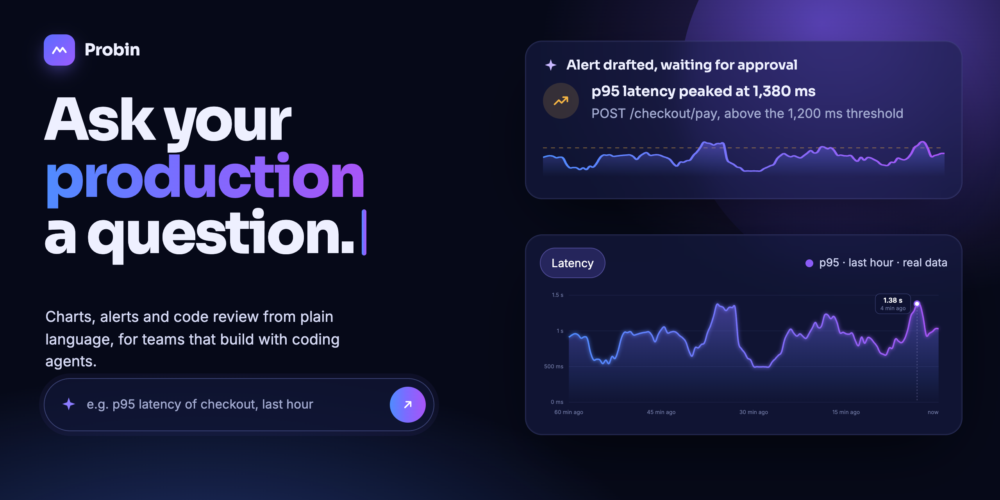
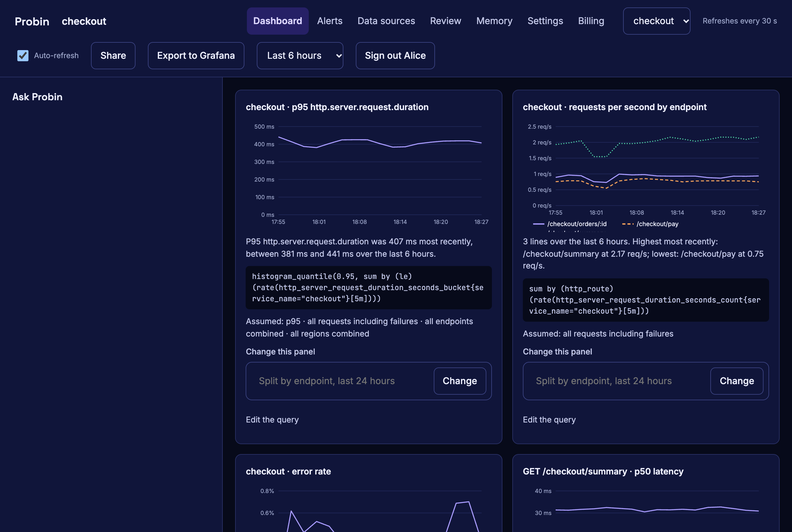
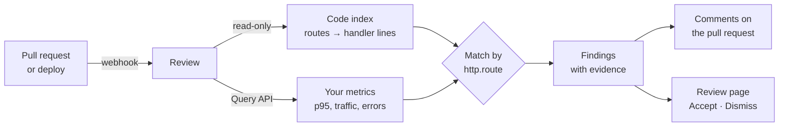
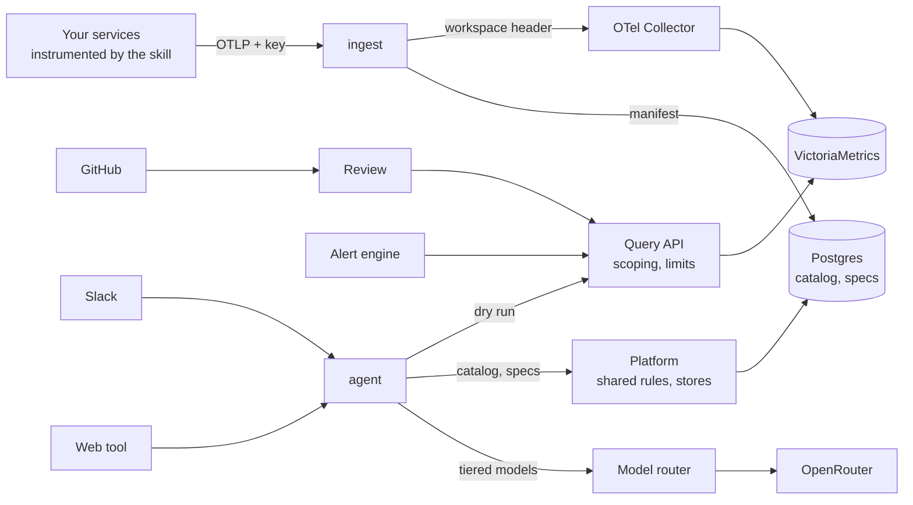

<div align="center">

# Probin

### Ask your production a question.

Type what you want to see, in Slack or the web. Probin finds the metric, writes the query, tests it,
and hands back a chart that shows its working. Then it reviews your code with those metrics in view.

**Built for teams whose software is written by coding agents like Claude Code.**

**[Live site: probin-wine.vercel.app](https://probin-wine.vercel.app)**

[](https://vercel.com/new/clone?repository-url=https%3A%2F%2Fgithub.com%2Fshubh-tiwari%2Fprobin)


[Two products](#two-products-one-platform) · [Watch](#watch-charts-and-alerts-from-a-sentence) ·
[Review](#review-a-code-reviewer-that-has-read-your-metrics) · [Quick start](#quick-start) ·
[Architecture](#architecture) · [Deploy](#deploy)

<br />



</div>

---

## Two products, one platform

|              | **Watch**                                                  | **Review**                                                                          |
| ------------ | ---------------------------------------------------------- | ----------------------------------------------------------------------------------- |
| **For**      | Anyone who wants to know what production is doing          | Engineers shipping changes                                                          |
| **You ask**  | "p95 latency of checkout in the last hour"                 | Nothing. It runs on every pull request and deploy                                   |
| **You get**  | A tested chart, a dashboard, an alert waiting for approval | Comments on the lines that matter, a weekly bottleneck report, a note after deploys |
| **Lives in** | Slack and the web tool                                     | GitHub and the Review page                                                          |

Both read the same metrics, which the Claude Code skill sets up once. Start with either one.

## Watch: charts and alerts from a sentence

Dashboards are slow to build, and asking a model for a query gives you something that _looks_ right:
a metric name it guessed, a label that doesn't exist, a chart of nothing. Probin closes that gap.

```text
alice  @bot p95 latency of checkout service in last 30 minutes
bot    Which endpoint?                    → POST /checkout/pay
bot    Count failed requests too?         → Yes, all requests
bot    P95 latency was 690 ms most recently, between 541 ms and 1410 ms over the last 30 minutes.
       [chart]
       Assumed: p95 · all requests including failures · all regions combined
       [Save to dashboard] [Alert me on this] [Open in web] [Skip questions next time]
```

At most two questions. Every other choice is stated as an assumption you can change. The query is
shown, and it has already been run against your data.

### How it works

1. **Instrument with Claude Code.** A skill adds OpenTelemetry metrics that follow one convention,
   and writes a manifest of every endpoint and metric.
2. **Ask in plain language.** In Slack or the web tool. The agent searches your catalog, asks what
   it can't infer, writes the query and runs it before you see it.
3. **Keep it, watch it.** Save it to a dashboard, or turn it into an alert that waits for a person
   to approve it.

### What you get

<table>
<tr>
<td width="50%" valign="top">

### 📊 Dashboards that explain themselves

Each panel shows its query, its assumptions and a one-line reading. Change a panel by typing
("split by endpoint, last 24 hours"). Share a read-only link, or export to Grafana.

</td>
<td width="50%"></td>
</tr>
<tr>
<td width="50%" valign="top">

### 🔔 Alerts that wait for a yes

"Alert me if checkout p95 goes above 800 ms" becomes a drafted rule. Nothing is watched until a
person approves it. New services get suggested rules, and "Why did this happen?" answers with
charts.

</td>
<td width="50%"></td>
</tr>
</table>

**Also included:** uptime checks on your own URLs from a sentence · a Prometheus-compatible read
API · a connector for coding agents (MCP) with production context · per-person memory ("skip questions next time") · Stripe
billing with a free trial · data export and deletion.

## For coding agents: production context while they write

A review comment after the pull request means another round: the agent reads it, revises and
pushes again. The connector gives the agent the same facts **before** it writes. Its
`production_context` tool takes the files the agent is about to edit and answers in a few lines,
from live metrics:

```text
infra/demo/inventory-python/main.py (service inventory)
- GET /inventory/stock/history (line 111, get_stock_history): p95 2418 ms, 0.165 req/s, 0% failed.
  It is the slowest of 4 endpoints in inventory.
  Where time goes: the handler waits for each step of the loop at line 115 in turn. Fetch the
  items in one query, or run the steps concurrently, so the time does not grow with the number
  of items.
```

It reads the files on the developer's machine, edits included, and the service manifest above
them; nothing is stored. The skill tells agents to call it before they change a request handler.
Add the connector to Claude Code with the command in the [phase 4 runbook](docs/runbooks/phase-4.md).

## Review: a code reviewer that has read your metrics

Most code review sees only the diff. Review also knows which endpoints are slow, how often they are
called and how often they fail, because it reads the same metrics as Watch. It is a GitHub App: you
install it on a repository from **Settings → GitHub**, and it starts working on the next pull
request.

### What it does

| Job                         | When it runs                                                 | What you get                                                                                                                                          |
| --------------------------- | ------------------------------------------------------------ | ----------------------------------------------------------------------------------------------------------------------------------------------------- |
| **Bottleneck report**       | Every Monday at 07:00 UTC, or on demand from the Review page | The slowest endpoints, ranked by p95, each linked to its handler's file and line, with a suggested fix                                                |
| **Pull request comments**   | Every pull request                                           | A note when the change touches an endpoint that matters ("your slowest endpoint in checkout"), with its current latency, traffic and error rate       |
| **Metric convention check** | Every pull request, on the added lines only                  | Inline comments on metrics that will cause trouble: wrong units, personal data in attributes, unbounded attributes, metrics missing from the manifest |
| **After-deploy follow-up**  | After a deploy, once the comparison window has passed        | A note on the pull request and in Slack, only if latency or errors moved                                                                              |
| **Architecture review**     | On demand                                                    | A map of which services call which, built from real traffic, with findings such as a call made on every request                                       |

### How it works



1. **Index the code.** For each commit, Review finds every route definition (Express and FastAPI),
   the handler's line range, outbound calls and the service's manifest. Only this index is kept, not
   the code.
2. **Join it to the metrics.** Each endpoint in the metrics carries its route template in
   `http.route`, so Review can say "POST /checkout/pay is slow, and its handler is
   `checkout/server.cjs` line 30".
3. **Explain the finding.** Every finding names the metric and time window it rests on, and the
   review page shows the query behind it. Suggested fixes come from the handler's code: a loop that
   waits on each step in turn, or a call to another service.
4. **Learn from dismissals.** Dismiss a kind of comment as not useful and Review stops posting that
   kind on that repository.

### Real comments from the demo repository

These were posted by Review on pull requests to the demo services (`pnpm verify:phase5` opens them).

> **This changes POST /checkout/pay, your slowest endpoint in checkout**
>
> Over the last 24h: p95 846 ms, 0.78 req/s, 0.5% failed. After this is deployed, I will compare
> the numbers and note here if latency or errors move.

> **The attribute user.id looks personal or secret** · _on `checkout/server.cjs`, line 62_
>
> No user ids, emails, tokens or other personal or secret values in metric attributes.

> **http.server.requests is a separate request counter** · _on `checkout/server.cjs`, line 8_
>
> Request counts and error rates come from http.server.request.duration. Remove this counter.

### Limits

- Review reads code and never pushes commits. Apart from comments, its GitHub access is read-only.
- Suggested fixes come from rules, not a model, for now.
- Routes are understood for Express (JavaScript) and FastAPI (Python).

**Try it locally:** sign in at <http://localhost:8094>, open **Settings → GitHub → Connect GitHub**
(the local GitHub approves at once), then **Review → Run the bottleneck report**. The full walkthrough
is in the [Review runbook](docs/runbooks/phase-5.md).

## Built to be checked, not trusted

These rules are enforced in code, not in a prompt:

| Promise                       | How                                                                                                         |
| ----------------------------- | ----------------------------------------------------------------------------------------------------------- |
| **No invented metrics**       | Every name in a generated query must exist in your catalog, or the query is refused before it runs.         |
| **Tested before you see it**  | Each query is dry-run against your data. Empty results are retried, or you are told nothing matches.        |
| **Your data stays yours**     | Every query is parsed and scoped to your workspace, and the metrics store enforces the same scope again.    |
| **Approval before watching**  | Alert rules and data sources do nothing until a person approves them. Editing sends them back for approval. |
| **Spending has a hard limit** | Model calls are routed by task, logged, and capped per workspace. Dashboards keep working at the cap.       |

## Quick start

You need Node 22.12 or newer, pnpm, [uv](https://docs.astral.sh/uv/) (for the Python agent), Docker with Compose, and Make.

```sh
git clone https://github.com/shubh-tiwari/probin.git
cd probin
make dev      # first run: creates .env from .env.example, then starts everything
pnpm ask "latency graph of checkout service in last 5 hr"
```

**Settings: nothing to fill in to try it.** The first `make dev` copies `.env.example` to `.env`:
local ports, the local database password, and values for the stand-in Slack, GitHub and Stripe,
all marked dev-only. It also makes a throwaway key for the stand-in GitHub in `.dev-secrets/`. Both
stay on your machine; git ignores them.

| To                                   | Do                                                                              |
| ------------------------------------ | ------------------------------------------------------------------------------- |
| Use real models                      | Add `OPENROUTER_API_KEY=…` to `.env`, then `make dev` again                     |
| Connect real Slack, GitHub or Stripe | Replace their values in `.env`; the [runbooks](#docs) say where each comes from |
| Free a port that is taken            | Change it in `.env`, for example `WEB_PORT=8094`                                |

`make dev` starts everything: Postgres, VictoriaMetrics, the OpenTelemetry Collector, every service,
two instrumented demo services (Node and Python) with traffic, and local stand-ins for Slack, GitHub
and Stripe. Then open <http://localhost:8094> and sign in with the local Slack.

**No keys needed.** With no model key, a built-in stand-in answers common requests, so nothing costs
money. To use real models, set `OPENROUTER_API_KEY` in `.env` and follow
[evals/README.md](evals/README.md).

```sh
make verify   # every phase's acceptance check, the integration tests and the query test set
make check    # lint, type-check and unit tests (no containers needed)
make help     # every command
```

## Architecture



Only the Query API can reach the metrics store, and only the agent calls a model. The agent, the
model router and the connector are Python; every other service is TypeScript. Rules both sides need
(catalog search, query analysis, spec validation, the stores) live once, in the platform service.

<details>
<summary><b>Repository layout</b></summary>

```text
apps/
  ingest/      ingestion endpoint: keys, OTLP in, manifest registration, catalog sync
  query-api/   the only service that talks to the metrics store: limits, isolation, cache
  agent/       the one agent (Python): tools, the "get a metric" loop, prompts, the query test set
  platform/    catalog search, query analysis, spec validation and the stores, for the agent
  slack/       the Slack app (and a fake Slack for development)
  web/         the web tool, billing, the read-only API (and a fake Stripe)
  alerts/      the alert engine
  review/      Review: GitHub app, code index, analyses (and a fake GitHub)
  connector/   the connector for coding agents (Python, MCP over stdio)
packages/
  config/      the product name constant; environment and plans loading
  specs/       types and validators for panel, dashboard, alert, collector, manifest
  db/          schema, migrations, spec store
  promql/      reads a query's names; scopes a query to a workspace
  catalog/     name mapping, registration, search, sync, the convention checks
  router/      model routing through OpenRouter (Python): tiers, budget, escalation, call log
  pycommon/    shared Python helpers: the product name, durations, value formatting
  agent-client/ the agent's HTTP client and types, for the TypeScript services
  memory/      per-workspace memory
  charts/      chart rendering (SVG, PNG) and the one-line reading
site/          the product site (deployed to Vercel)
skill/         the skill for Claude Code (source; `pnpm skill:build` fills in the name)
evals/         the query test set and the review test set
infra/         compose file, collector config, demo services and their baselines
config/        example plans and models files
docs/          the build plan, decisions, runbooks, screenshots
scripts/       acceptance checks and repository checks
```

</details>

## Deploy

**The product site** deploys to Vercel: import this repository at
[vercel.com/new](https://vercel.com/new) and keep the defaults. `vercel.json` does the rest. Build
it locally with `pnpm site:build`.

**The product itself** runs on [Railway](https://railway.com), in either of two setups:

- **Demo:** the whole product with stand-in Slack, GitHub and Stripe, demo services and live
  traffic. Anyone with the link can try it. `pnpm railway:env demo` writes every service's
  settings.
- **Real:** your own Slack app, GitHub App and Stripe account. `pnpm railway:env real`.

The [Railway runbook](docs/runbooks/railway.md) walks through both. Anywhere else, it runs with
Docker Compose on a server with a public HTTPS address.

## Docs

| Read this                            | For                                                    |
| ------------------------------------ | ------------------------------------------------------ |
| [Build plan](docs/build-plan.md)     | What the product is and the six phases it was built in |
| [Decisions](docs/decisions.md)       | Choices the plan left open, and why                    |
| [Runbooks](docs/runbooks/phase-0.md) | Running, connecting and fixing each part (see below)   |
| [Query test set](evals/README.md)    | Measuring the agent, and switching to real models      |

<details>
<summary>All runbooks</summary>

- [Foundations](docs/runbooks/phase-0.md): the stores, the collector, local setup
- [Core loop](docs/runbooks/phase-1.md): ingestion, catalog, agent, real models
- [Slack](docs/runbooks/phase-2.md): the Slack app and connecting a real workspace
- [Web tool](docs/runbooks/phase-3.md): dashboards, sharing, the read API
- [Alerts and billing](docs/runbooks/phase-4.md): alert rules, data sources, Stripe
- [Review](docs/runbooks/phase-5.md): GitHub App, reports, pull request comments
- [Railway](docs/runbooks/railway.md): deploying the demo or the real setup

</details>

## Status

All six phases in the [build plan](docs/build-plan.md) are built, and each passes its acceptance
check against the local stack. Still to do:

- Measure the query gate (90% of the test set right on the first try) with a real model key.
- Connect real Slack, GitHub and Stripe apps, and run a pilot with real people.
- Choose plan names and prices (the plans file holds example values only).

## Contributing

- Build one phase at a time. A phase is done when its acceptance tests pass.
- The product name lives in one constant, `PRODUCT_NAME` in `packages/config`. Do not write it
  anywhere else in code, configuration, package names or URLs. `pnpm check:product-name` enforces
  this.
- No secrets in the repository. Keys come from the environment.
- Tests ship with the code. Choices the plan leaves open are recorded in
  [docs/decisions.md](docs/decisions.md).
