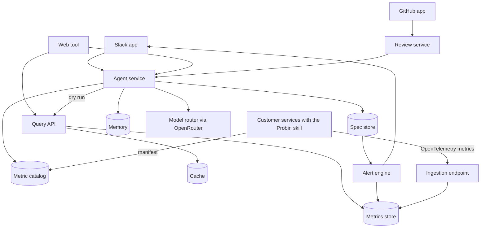

> **Snapshot.** This is a copy of the live build plan, taken on 2026-11-18 at revision 19.
> The live document is the source of truth: <https://claude.ai/artifact/WmscD2SENiG5W68yKZoEL3>.
> Do not edit this file by hand; refresh it from the live document when the plan changes.
> Choices made while building are recorded in [decisions.md](decisions.md).

# Probin build plan for Claude Code

2026-11-18 · Shubham Tiwari

## Start here

This is the single build plan for Probin. It is written for Claude Code to build from, phase by phase, and for the team to review.

**What Probin is.** A hosted subscription product for small teams whose software is written with Claude Code. It has two products on one shared platform:

- **Probin Watch:** anyone asks for a chart, alert or data source in plain language, in Slack or a simple web tool. An AI agent turns the request into a tested query and a saved panel.
- **Probin Review:** a reviewer that uses production metrics to find bottlenecks, comment on pull requests and review architecture.

**How to use this plan, Claude Code.**

1. Build one phase at a time, in the order in “Build phases”. Do not start a phase until the previous phase’s acceptance tests pass.
2. Treat the “Fixed decisions” table as settled. Do not reopen them; raise a question instead.
3. Where this plan says “default”, the choice is a recommendation. Keep it unless there is a concrete reason, and say so in the pull request if you change it.
4. Follow the “Rules that must always hold” in the agent section. A change that breaks one of them is wrong even if tests pass.
5. The product name is Probin. Still keep it in one constant, `PRODUCT_NAME`, and never hard-code “Probin” in user-facing text, package names or URLs.
6. When something is missing or ambiguous, stop and ask rather than invent it. The open items are listed at the end.

### Fixed decisions

| Topic | Decision |
| --- | --- |
| Audience | Small teams whose code is written with Claude Code |
| Delivery | Hosted, sold as a subscription. Probin runs the backend and the metrics store |
| Surfaces | Slack app first, then a simple web tool. Both use the same agent and the same saved specs |
| Metrics store | VictoriaMetrics by default, hosted by Probin. Prometheus also supported, set in configuration. A customer may connect a store they already run |
| Metric naming | OpenTelemetry semantic conventions, applied by the Probin skill for Claude Code |
| Which services | First release: services built or retrofitted with the skill, or using OpenTelemetry auto-instrumentation. Other metrics come later |
| AI at build time only | The model is called when someone builds or asks. Dashboard refresh and alert evaluation never call it |
| Model choice | An auto-router picks the model per request through OpenRouter, open models included |
| Approvals | Alert rules and collectors start as pending. Anyone in the Slack channel or the web tool can approve; the approver’s name is recorded |
| Cross-check questions | At most two per request. Everything else is a stated assumption the user can edit |
| Grafana | A one-time export of a dashboard to Grafana. No sync |
| Shared platform | Memory and caching are shared by Probe and Review, isolated per workspace |

## Architecture

The agent writes specs. Everything that runs on a schedule or on page load is ordinary code reading those specs.



| Component | Responsibility | Calls the model |
| --- | --- | --- |
| Slack app | Mentions, chart images, buttons, approvals, alert messages | No |
| Web tool | Ask panel, draft preview, dashboard grid, alerts list | No |
| Agent service | Turns a request into a tested query and a spec, using tools | Yes |
| Model router | Picks a model per request, enforces the budget cap, escalates on failure | Yes |
| Query API | Runs stored and dry-run queries, enforces limits and workspace isolation, caches | No |
| Spec store | Dashboards, panels, alert rules, collectors, with versions | No |
| Metric catalog | Metric names, types, units, labels, descriptions, endpoints, from manifests and the store | No |
| Memory | Per-workspace facts both products read | No |
| Alert engine | Evaluates approved rules only, notifies Slack | No |
| Ingestion endpoint | Receives OpenTelemetry metrics per workspace key, writes to the store | No |
| Review service | Bottleneck reports, pull request comments, architecture review | Through the agent |

### Stack (defaults)

| Layer | Default | Notes |
| --- | --- | --- |
| Language | TypeScript everywhere | One language for Slack, web, services and shared types |
| Runtime and services | Node, current LTS, with a small HTTP framework | One deployable per service in `apps/` |
| Database | Postgres | Spec store, catalog, memory, accounts, job queue |
| Background jobs | A Postgres-backed job queue | No extra infrastructure for a small product |
| Metrics store | VictoriaMetrics; Prometheus as an alternative | Reached only through the Prometheus-compatible query API, so the rest of the code does not change |
| Ingestion | OpenTelemetry Collector in front of the store | Accepts OTLP, adds the workspace label, forwards |
| Models | OpenRouter | No provider-specific code outside the router package |
| Slack | Slack’s official app framework for JavaScript | Charts rendered to PNG on the server |
| Web | React with a charting library and a grid layout | Same chart renderer as the Slack images where possible |
| Sign-in | Sign in with Slack | Email sign-in can follow |
| Billing | A hosted billing provider | Plans and prices come from configuration; none are set yet |
| Local development | One compose file starting Postgres, the metrics store, the collector and a demo service | `make dev` or equivalent brings everything up |

Workspace isolation for metrics: every sample carries a `workspace` label set at ingestion, and the query API injects that label into every query. Code outside the query API never talks to the metrics store.

### Repository layout

```text
apps/
  agent/        agent service: tools, loop, prompts
  query-api/    query execution, limits, isolation, cache
  slack/        Slack app
  web/          web tool
  alerts/       rule generation and notifications
  ingest/       collector config and key management
  review/       Probin Review service and GitHub app (phase 5)
packages/
  specs/        types and validators for panel, dashboard, alert, collector, manifest
  catalog/      catalog sync and search
  router/       model routing through OpenRouter
  memory/       memory read and write
  charts/       chart rendering shared by web and Slack
  db/           schema and migrations
skill/          the Probin skill for Claude Code
evals/          query test set and review test set
infra/          compose file, deployment config
docs/           this plan, decisions, runbooks
```

## Data model and formats

Every table carries `workspace_id`. Every spec row is versioned and stores who or what created it.

| Table | Key fields |
| --- | --- |
| `workspaces` | name, plan, ingestion key hash, monthly model budget, metrics store config |
| `users` | workspace, Slack user id, name, role (admin or member), personal defaults |
| `dashboards` | title, layout, panel ids, default time range |
| `panels` | type, query, unit, range, thresholds, original request, assumptions, version, created by |
| `alert_rules` | expression, duration, severity, channel, status (pending or active), approved by, approved at |
| `collectors` | source type, config, interval, metric names, status, approved by |
| `catalog_metrics` | service, metric name, stored name, type, unit, labels, description, last seen |
| `catalog_endpoints` | service, method, route, last seen, request rate, p95 (refreshed periodically) |
| `memory_entries` | kind, subject, text, source, created by, last used |
| `review_findings` | repository, pull request or report id, kind, evidence (metric and window), status (open, accepted, dismissed) |
| `model_calls` | request id, model, tokens, cost, outcome, escalated from |

### Panel spec

The agent’s output is a spec, never chart code. The time range lives outside the query so the dashboard’s time picker can change it without the agent.

```json
{
  "title": "POST /checkout/pay · p95 latency",
  "type": "timeseries",
  "query": "histogram_quantile(0.95, sum by (le) (rate(http_server_request_duration_seconds_bucket{service_name=\"checkout\", http_route=\"/checkout/pay\", http_request_method=\"POST\"}[5m])))",
  "unit": "s",
  "display_unit": "ms",
  "range": "5h",
  "thresholds": [],
  "request": "latency graph of checkout service in last 5 hr",
  "assumptions": ["p95", "all requests including failures", "all regions combined"]
}
```

The stored metric and label names in this example are the expected Prometheus-style forms of the OpenTelemetry names. Confirm the exact stored names against the metrics store in phase 1 and keep the mapping in `packages/catalog`, in one place.

Panel types for the first release: `timeseries`, `bar`, `stat`.

### Alert rule spec

```json
{
  "name": "Checkout p95 high in ap-south",
  "expr": "<query> > 0.8",
  "for": "5m",
  "severity": "warning",
  "channel": "#ops-monitoring",
  "status": "pending"
}
```

A rule must have a `for` duration. Only `active` rules are compiled into the alert engine’s rule files.

### Service manifest

Written by the Probin skill into each repository as `probin.yaml` and sent to Probin on registration.

```yaml
service: checkout
description: Handles cart, payment and order confirmation
endpoints:
  - method: POST
    route: /checkout/pay
    description: Charges the customer and creates the order
  - method: GET
    route: /checkout/summary
    description: Returns the order summary before payment
metrics:
  - name: http.server.request.duration
    type: histogram
    unit: s
    description: Duration of requests this service handles
  - name: orders.completed
    type: counter
    unit: "{order}"
    description: Orders paid successfully
    attributes: [payment.method]
```

## The agent

One agent serves Slack, the web tool and Review. It receives a request, the workspace’s relevant memory, and a set of tools. It may only act through the tools.

### Tools

| Tool | Input | Returns | Side effect |
| --- | --- | --- | --- |
| `search_catalog` | free text, optional service | matching metrics with stored name, type, unit, labels, description; endpoints for a service | none |
| `run_query` | query, range | sample of the result, line count, duration, or an error | none; time limit and line cap enforced |
| `save_panel` | panel spec, dashboard id | panel id and version | writes a spec |
| `draft_alert` | alert rule spec | rule id, status pending | writes a pending spec |
| `draft_collector` | collector spec | collector id, test fetch result | writes a pending spec, runs one test fetch |
| `explain_series` | query, time window | the series plus related series around the window | none |
| `ask_user` | one question with 2 to 6 options | the chosen option | renders buttons or a picker |
| `read_memory` / `write_memory` | subject, text | matching entries / entry id | writes are shown on the memory page |

### The loop for “get a metric”

1. Parse the request into measure, target, range and chart type.
2. `search_catalog` for the measure and target. If nothing matches, say so; never guess a metric name.
3. If the service has more than one endpoint and none was named, `ask_user` with the endpoint list, including “All endpoints combined”.
4. Decide what is still ambiguous. Ask at most two questions in total, counting the endpoint question. Fill the rest from the user’s defaults in memory, then from product defaults (p95, all requests, all regions).
5. Write the query and `run_query` it.
6. If it errors, returns nothing, or exceeds the line cap, fix and retry, up to three attempts. After two failures the router moves to a stronger model.
7. Show a draft panel with the query and the assumptions. `save_panel` only when the user confirms.

### Model routing

- All calls go through `packages/router`, which calls OpenRouter.
- Each call is tagged with a task type: `parse`, `ask`, `write_query`, `explain`, `review`. The router maps task types to a model tier.
- A model is eligible for a tier only if it passes the test set in `evals/` for that tier, including reliable tool use.
- Each workspace has a monthly budget. Near the cap the router prefers cheaper eligible models; at the cap, building pauses and viewing continues.
- Every call is logged to `model_calls`.
- To settle in phase 1: use OpenRouter’s own automatic routing, or the task-type table above. Build the table first; it is simple and testable.

### Rules that must always hold

1. **Catalog grounding.** A generated query may only use metric and label names returned by `search_catalog`. Validate this in code, not in the prompt.
2. **Dry run before display.** No query reaches a user or a spec without passing `run_query`.
3. **No model on refresh.** Loading a dashboard, rendering a saved panel and evaluating an alert never call the model.
4. **Approval before effect.** Alert rules and collectors do nothing while pending.
5. **Read-only toward customer systems.** The agent reads metrics and code. It never writes to a customer’s services or repositories.
6. **Workspace isolation.** Every query, spec, memory entry and cache key is scoped to one workspace, enforced below the agent.
7. **Show the work.** Every panel keeps its query, assumptions and original request. Every review finding names the metric and time window behind it.
8. **Explanations are hypotheses.** “Why did this happen” answers are labelled as hypotheses with the charts behind them.

## Probin Watch

The screens are mocked up in the [design canvas](https://claude.ai/artifact/USfyh4MWqymH4816MNjyEP): the Slack thread, the web dashboard, and the endpoint picker with cross-check questions. Match their structure and wording; the visual styling is a starting point.

### Flows

| Flow | Trigger | Result |
| --- | --- | --- |
| Get a metric | “latency graph of checkout service in last 5 hr” | Endpoint picker if needed, up to two questions, a draft panel, then a saved panel |
| Refine | “split by region”, “last 24h” in the same thread or on a panel | A new version of the same panel |
| Create an alert | “alert me if ap-south goes above 800 ms for 5 min” or the “Alert me on this” button | A pending rule card with Approve, Edit, Discard |
| Alert fires | An active rule is true for its duration | A message with the value and threshold, and Why did this happen?, Snooze 1 hour, Acknowledge |
| Explain a change | “Why did this happen?” on a chart or alert | A hypothesis with the supporting charts |
| Add a data source | “monitor [URL]/health every minute” | A pending collector card with a test fetch result, Approve, Edit |

### Cross-check questions

| Question | Asked when | Default if not asked |
| --- | --- | --- |
| Which endpoint? | The service has more than one and none was named | None; the user must choose |
| Which latency: typical (p50), slow tail (p95) or worst 1% (p99)? | The metric is a histogram and no percentile was named | p95 |
| Count failed requests too? | The metric has a status attribute | All requests |
| Region | Never asked; shown as an assumption | All combined |
| Time range | Never asked when the request gave one; read back | Dashboard range |

The endpoint picker lists real endpoints from the catalog with a filter box, “Slowest” and “Busiest” tags, and “All endpoints combined” as the last option. “Skip questions next time” saves the answers as the user’s defaults in memory.

### Slack app

| # | Requirement | Priority |
| --- | --- | --- |
| S1 | Respond to mentions in channels and to direct messages | P0 |
| S2 | Reply in the thread with a chart image, a one-line reading of it, and the query | P0 |
| S3 | Endpoint picker and cross-check questions as buttons or a select menu | P0 |
| S4 | Buttons under each chart: Save to dashboard, Alert me on this, Open in web | P0 |
| S5 | Pending alert rule card with Approve, Edit, Discard | P0 |
| S6 | Firing alert message with Why did this happen?, Snooze 1 hour, Acknowledge | P1 |
| S7 | Follow-ups in the same thread refine the last chart | P1 |
| S8 | Scheduled chart posts to a channel | P2 |

Charts in Slack are PNG snapshots rendered on the server. They do not refresh.

### Web tool

| # | Requirement | Priority |
| --- | --- | --- |
| W1 | “Ask Probin” panel beside the dashboard, text box labelled “What do you want to see?” | P0 |
| W2 | Draft panel preview that updates as the user answers cross-check questions | P0 |
| W3 | Dashboard grid with line, bar and single-number panels | P0 |
| W4 | Time range picker and auto-refresh that work with no model call | P0 |
| W5 | Query shown under every panel and editable by hand | P0 |
| W6 | Edit a panel by prompt from its header | P1 |
| W7 | Alerts list with status: Firing, OK, Pending approval | P1 |
| W8 | Pending collector card with test result, Approve, Edit | P1 |
| W9 | Share a dashboard by link | P1 |
| W10 | Panel version history with the request behind each version | P2 |
| W11 | Works at phone width | P2 |
| W12 | One-time export of a dashboard to Grafana | P1 |

Accessibility for the web tool: real buttons, links and labelled inputs; text contrast of at least 4.5 to 1; series in a chart differ by more than colour.

## The Probin skill for Claude Code

The skill is how metrics get into Probin. It lives in `skill/` in this repository and is installed by customers into their own Claude Code. It makes every service Claude Code builds or changes emit the same metrics, named the same way, and register with Probin.

### What the skill instructs Claude Code to do

1. **Instrument.** Add OpenTelemetry metrics to each service using the language’s OpenTelemetry SDK and, where available, its HTTP auto-instrumentation.
2. **Describe.** Write or update `probin.yaml` (format above) whenever endpoints or metrics change.
3. **Connect.** Configure the OTLP exporter to send to the workspace’s ingestion endpoint. The key comes from an environment variable and is never written to the repository.
4. **Register.** Send the manifest to Probin’s registration endpoint.
5. **Ask back.** Use the Probin connector, when installed, to query metrics while working.

### Convention

OpenTelemetry semantic conventions, not names of Probin’s own ([HTTP metrics spec](https://opentelemetry.io/docs/specs/semconv/http/http-metrics/)).

| What is measured | Metric | Type and unit | Key attributes |
| --- | --- | --- | --- |
| Requests the service handles | `http.server.request.duration` | Histogram, seconds | `http.request.method`, `http.route`, `http.response.status_code` |
| Calls the service makes to others | `http.client.request.duration` | Histogram, seconds | `http.request.method`, `server.address`, `http.response.status_code` |
| Background jobs | Custom, same naming style | Histogram, seconds | job name, result |
| Business metrics the owner asks for | Custom, same naming style | Counter or gauge | A short fixed set |

Rules the skill enforces:

- Base units only: seconds and bytes.
- `http.route` is the route template (`/orders/{id}`), never the full URL.
- No user ids, emails, tokens or other personal or secret values in names or attributes.
- No attribute with unbounded values.
- Request counts and error rates come from the duration histogram. Do not add a separate request counter.

### Skill requirements

| # | Requirement | Priority |
| --- | --- | --- |
| K1 | The skill applies the convention to every service Claude Code builds or changes | P0 |
| K2 | `probin.yaml` written and kept in step with the code | P0 |
| K3 | Metrics sent to the workspace ingestion endpoint with a key kept out of the repository | P0 |
| K4 | Probin ingests the manifest and fills the catalog | P0 |
| K5 | Starter dashboard and suggested alerts drafted on first registration, pending approval | P1 |
| K6 | Probin connector so Claude Code can query metrics while working | P1 |

The skill must be tested against a small demo service in at least two languages, kept in `infra/` for local development and the test set.

## Memory and caching

Both are platform packages used by Probe and Review. Both are scoped to one workspace and deleted with it.

### Memory

| Kind | Example | Written by | Read by |
| --- | --- | --- | --- |
| `user_default` | Prefers p95, skip questions | “Skip questions next time” | Probe question logic; Review comment style |
| `team_decision` | “/reports/export is allowed to be slow” | A person, in Slack or the memory page | Probe alert suggestions; Review findings |
| `incident` | Alert fired on checkout p95, explanation given | Alert engine and the agent | Probe explanations; Review warnings on related code |
| `service_map` | checkout calls payments and inventory | Catalog sync, from manifests and outbound-call metrics | Starter dashboards; architecture review |
| `review_feedback` | Comment type X dismissed three times | Review service | Review only |

- A memory page in the web tool lists every entry. Anyone in the workspace can edit or delete one.
- The agent may write `user_default` and `incident` entries by itself. A `team_decision` needs a person.
- Only the entries relevant to a request are passed to the model, not the whole memory.

### Caching

| Cache | Key | Lifetime | Purpose |
| --- | --- | --- | --- |
| Query results | workspace, query, range, step | Short, about the refresh interval | Fast dashboards, less load on the store |
| Resolved requests | workspace, normalised request text | Until the catalog changes for that service | A repeated request reuses the saved query; only data is refetched |
| Model context | provider prompt cache, where supported | Provider-defined | Catalog, conventions and memory are not paid for on every call |
| Code index | workspace, repository, commit | Until the commit is no longer on a tracked branch | Review reads only what changed |

A cache entry is never shared across workspaces, and a cached request result is never reused after its service’s catalog entry changes.

## Probin Review

Probin Review is the reviewer that knows how the code behaves in production. It does not try to beat general AI code reviewers at finding ordinary bugs; it adds what they cannot see, which is live metrics. It is built last, in phase 5.

| Capability | Reads | Produces | Build order |
| --- | --- | --- | --- |
| Bottleneck report | Latency, errors and traffic per endpoint; the handler code behind each | A ranked list of the slowest and most error-prone endpoints, each linked to its code with a suggested fix | First |
| Convention check | The diff and `probin.yaml` | A pull request comment when an endpoint has no metrics or an attribute breaks the rules | First |
| Pull request review | The diff, the code index, live metrics for touched endpoints | Comments such as “this changes your slowest endpoint, p95 is 800 ms” | Second |
| Post-deploy follow-up | Metrics before and after a deploy for changed routes | A note on the pull request and in Slack when latency or errors moved | Second |
| Architecture review | Manifests and the calls services actually make to each other | A service map with findings: chatty pairs, single points of failure, endpoints nothing calls | Third |

| # | Requirement | Priority within Review |
| --- | --- | --- |
| R1 | GitHub app with read access to repositories and pull requests, and permission to comment | P0 |
| R2 | Bottleneck report, on demand and weekly | P0 |
| R3 | Convention check on every pull request | P0 |
| R4 | Metrics-aware comments on pull requests that touch a measured endpoint | P1 |
| R5 | Post-deploy follow-up for changed routes | P1 |
| R6 | Feedback goes to memory: a dismissed comment type is not repeated | P1 |
| R7 | Review page for long reviews that people can comment on | P1 |
| R8 | Architecture review built from the real service map | P2 |

Limits:

- Review reads code and never pushes commits. Fixes are suggestions for a person or Claude Code to apply.
- Repository access is read-only. Code is kept only as the cached index.
- Every finding names the metric and time window it rests on.
- Linking an endpoint to its handler uses `http.route` from the metrics and the route definitions in the code index. When no match is found, the finding says so instead of guessing.
- Probin does not open comment threads on other Claude artifacts. Long reviews are published as Probin’s own review page; people comment there. Confirm what the artifact platform allows before building R7.

## Hosted product

Probin is sold as a subscription covering the tool, the hosted backend and model usage.

| # | Requirement | Priority |
| --- | --- | --- |
| H1 | One workspace per customer; metrics, specs, catalog, memory and caches isolated between workspaces | P0 |
| H2 | Sign-up and sign-in with Slack | P0 |
| H3 | Roles: admin and member. Any member can approve alert rules and collectors | P0 |
| H4 | An ingestion endpoint and key per workspace; keys can be rotated | P0 |
| H5 | Subscription and billing: plan, payment, invoices, cancel | P0 |
| H6 | Usage shown to the admin: metrics stored, model spend against budget | P1 |
| H7 | Data retention per plan; export and deletion on cancel | P1 |
| H8 | Connect an existing Prometheus or VictoriaMetrics, read-only, instead of the hosted store | P1 |

Pricing shape, proposed and not final: one flat monthly price per workspace, not per seat, with included limits on metrics stored and model usage; a time-limited free trial; one hosting region at launch. Read plan names, limits and prices from configuration. Do not hard-code any of them.

## Build phases

Six phases, numbered 0 to 5, in order. Each ends with acceptance tests that must pass before the next begins. The gate numbers are proposals to confirm once there is baseline data. No dates are set.

### Phase 0: Foundations

- [ ] Repository with the layout above, shared lint, type-check and test commands, and continuous integration
- [ ] Compose file that starts Postgres, the metrics store, the collector and a demo service
- [ ] Database schema and migrations for the tables in “Data model”
- [ ] `packages/specs`: types and validators for panel, dashboard, alert rule, collector and manifest
- [ ] `PRODUCT_NAME` constant and configuration loading for plans, limits and store type

Accepted when: one command brings up the whole stack locally, and the demo service’s metrics are visible in the metrics store.

### Phase 1: Core loop

- [ ] The Probin skill (K1 to K3), tested on the demo service in two languages
- [ ] Ingestion endpoint with per-workspace keys and the `workspace` label
- [ ] Manifest registration and catalog sync (K4), including the mapping from OpenTelemetry names to stored names
- [ ] Query API with time limit, line cap, workspace injection and result cache
- [ ] `packages/router` with task-type routing, budget cap, escalation and call logging
- [ ] Agent service with `search_catalog`, `run_query`, `ask_user` and `save_panel`, and the “get a metric” loop
- [ ] Catalog-grounding validator in code
- [ ] Query test set in `evals/`: at least 50 requests with expected results, run in continuous integration
- [ ] A command-line harness to send a request and print the draft panel spec

Accepted when: 90% of test-set requests pass the dry run on the first attempt; no generated query uses a name outside the catalog; a query from workspace A cannot return workspace B’s data.

### Phase 2: Slack

- [ ] Slack app install flow and sign-in with Slack (H2), creating a workspace (H1)
- [ ] Mentions and direct messages (S1), replies with chart image, reading and query (S2)
- [ ] Server-side chart rendering in `packages/charts`
- [ ] Endpoint picker and cross-check questions as Slack controls (S3), with the two-question limit
- [ ] Buttons: Save to dashboard, Alert me on this, Open in web (S4)
- [ ] `user_default` memory and “Skip questions next time”

Accepted when: a person with no query knowledge gets a correct chart for the example request in one Slack thread; in a one-channel pilot, 70% of charts are saved or kept without editing the query; median time from request to chart is under 10 seconds.

### Phase 3: Web tool

- [ ] Dashboard grid with timeseries, bar and stat panels (W3)
- [ ] Ask panel and live draft preview (W1, W2)
- [ ] Time range picker and auto-refresh (W4); query shown and editable (W5)
- [ ] Memory page
- [ ] Resolved-request cache

Accepted when: loading and refreshing a saved dashboard makes zero model calls, verified by a test on `model_calls`; the three canvas screens are implemented; the accessibility points in “Web tool” hold.

### Phase 4: Alerts, sources and the paid product

- [ ] `draft_alert`, pending rule cards and approval in Slack and web (S5, W7)
- [ ] Rule compilation for active rules only, and the alert engine
- [ ] Firing messages with Why did this happen?, Snooze, Acknowledge (S6); `explain_series`; `incident` memory
- [ ] `draft_collector` with test fetch and approval (W8)
- [ ] Starter dashboard and suggested alerts on first registration (K5)
- [ ] Refine in thread (S7), edit a panel by prompt (W6), share by link (W9), Grafana export (W12)
- [ ] Billing, plans from configuration, usage page (H5, H6); retention, export and deletion (H7)
- [ ] Connect an existing store (H8); Probin connector for Claude Code (K6)

Accepted when: a pending rule never notifies; an approved rule fires on the demo service within its duration; cancelling a workspace deletes its metrics, specs, memory and caches; a trial workspace can subscribe and be billed in the provider’s test mode.

### Phase 5: Probin Review

- [ ] GitHub app (R1) and the code index cache
- [ ] Bottleneck report (R2) and convention check (R3)
- [ ] Metrics-aware pull request comments (R4) and post-deploy follow-up (R5)
- [ ] `review_feedback` memory (R6) and the review page (R7)
- [ ] `service_map` memory and architecture review (R8)
- [ ] Review test set in `evals/`: seeded slow endpoints and convention breaks in the demo services

Accepted when: the bottleneck report ranks the seeded slow endpoints first and links each to the right handler; the convention check flags every seeded break and nothing else in the test set; a dismissed comment type is not repeated on the next pull request.

### In every phase

- Tests ship with the code. Each “Rule that must always hold” has at least one automated test.
- No secrets in the repository. Keys come from the environment.
- Each phase ends with a short runbook in `docs/` for running and debugging what was built.

## Open items

These are not decided. Do not choose for the team; build so the answer can be changed in configuration, and ask when one blocks you.

| Item | Status | What to do meanwhile |
| --- | --- | --- |
| Product name | Decided: Probin. A first search found no software product or software trademark using it. The earlier name, Glint, was dropped after a trademark check. A lawyer’s view on Probin is still needed before launch | Use `PRODUCT_NAME` everywhere |
| Prices and plan limits | Wait on real cost per workspace from phase 1 | Read from configuration |
| Exact stored metric and label names | To confirm against the metrics store in phase 1 | Keep the mapping in one place in `packages/catalog` |
| OpenRouter automatic routing or Probin’s own table | To test in phase 1 | Build the task-type table first |
| Auto-instrumentation coverage per language | Not verified | Support it where the OpenTelemetry project provides it; document which languages were tested |
| What the artifact platform allows for review pages and comments | Not verified against official documentation | Confirm before building R7 |
| Success gate numbers (90%, 70%, 10 seconds) | Proposals | Treat as targets; report actuals at the end of each phase |

## Sources

- [Probin PRD](https://claude.ai/artifact/Bs7KsDv6kBegdRoA52rv95): the product reasoning, risks and the decisions behind this plan
- [Design canvas](https://claude.ai/artifact/USfyh4MWqymH4816MNjyEP): Slack thread, web dashboard, endpoint picker and cross-check screens
- [OpenTelemetry HTTP metrics conventions](https://opentelemetry.io/docs/specs/semconv/http/http-metrics/)

Where this plan and the PRD disagree, this plan is newer and wins; flag the difference so the PRD can be corrected.
